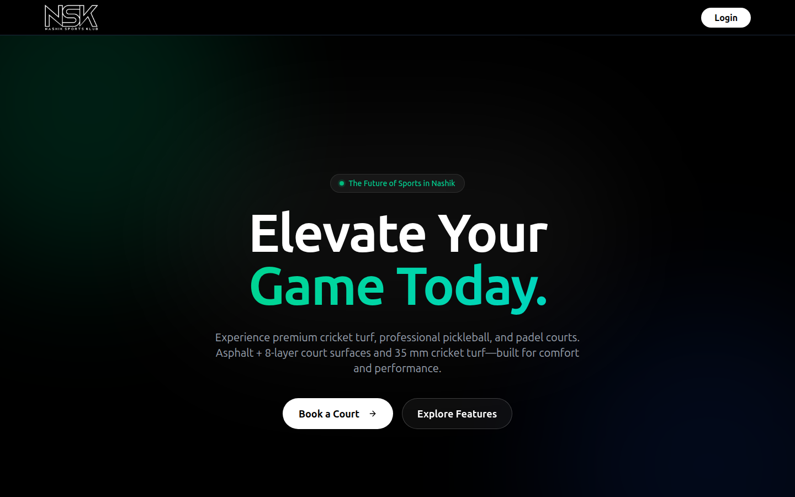
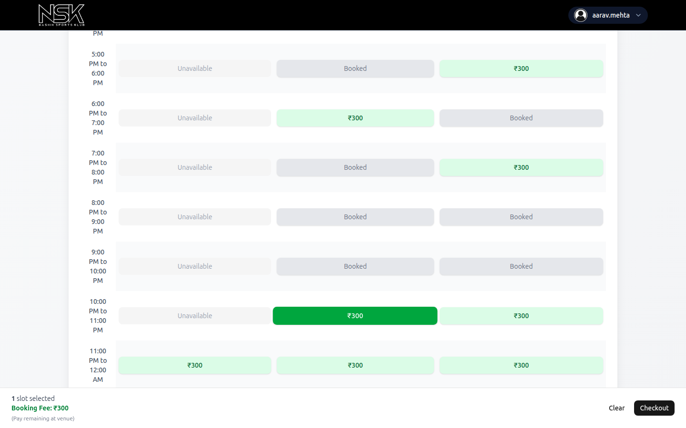
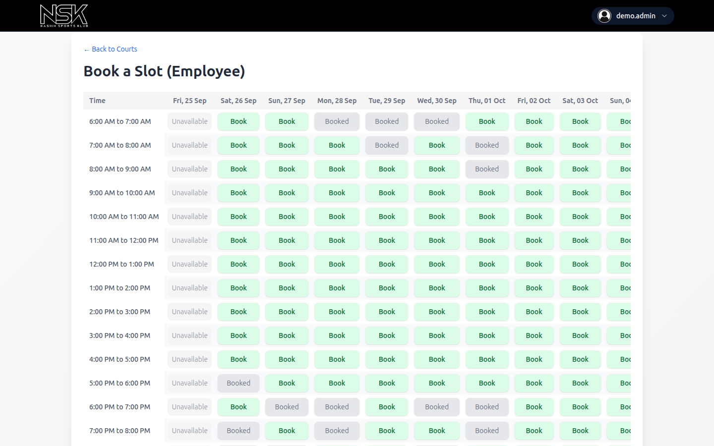

<h1>Nashik Sports Klub</h1>

The booking site for a sports club in Nashik. Players book pickleball, cricket, and padel courts online, and the club's staff run walk-ins, courts, and customers from the same app.

 

[nashiksportsklub.com](https://www.nashiksportsklub.com) is live and takes real bookings for the club's three venues: four pickleball courts, two cricket turfs, and a padel court. The code lives in a private repository because it runs a paying business, so this page shows what it does and how the interesting parts work.

## Booking a court

Players sign in with their phone number, pick a venue and a court, and choose from a grid of open slots over the next few days. Taken slots are greyed out, and each open one shows its price. Selecting slots brings up the booking fee, which is paid online through Razorpay, and the rest is paid at the venue.

## Running the club

Admins and staff each get a dashboard for their venue. The staff view lays out a whole week for each court, so a phone call or a walk-in can be booked in a couple of clicks. Admins also see every booking with the customer's contact details, recent customers, a past-week report, and revenue analytics, and they can change court prices and hours, give staff access, and block numbers that shouldn't be booking.

The screenshots come from a local copy running on made-up customers, so no real bookings are shown.

## Two people, one slot

The hard part of a booking site is the last open slot. When a player checks out, the server opens a MongoDB transaction, checks that nothing overlaps the chosen slots, and places a hold on each one before creating the payment order. A hold lasts three minutes, and a scheduled Agenda job clears it if the payment never finishes. A unique index on court and start time also stops two holds on the same slot inside the database itself, and each player can only have one checkout in progress at a time.

To check it, I sent 500 simulated users at the same slot at once. Exactly one booking went through, 472 requests were turned away with `409 Conflict`, and about 27 timed out against my machine's connection pool limit.

## Built with

| Part | Tools |
|---|---|
| Frontend | React 19, TypeScript, Vite, TanStack Router and Query, Redux Toolkit, Tailwind CSS 4, shadcn/ui |
| Backend | Node.js, Express 5, Mongoose, Agenda |
| Database | MongoDB |
| Payments and sign-in | Razorpay, phone verification through Phone.Email, JWTs in HttpOnly cookies |

## Contact

Yash Khambhatta, [yash456k@gmail.com](mailto:yash456k@gmail.com)
